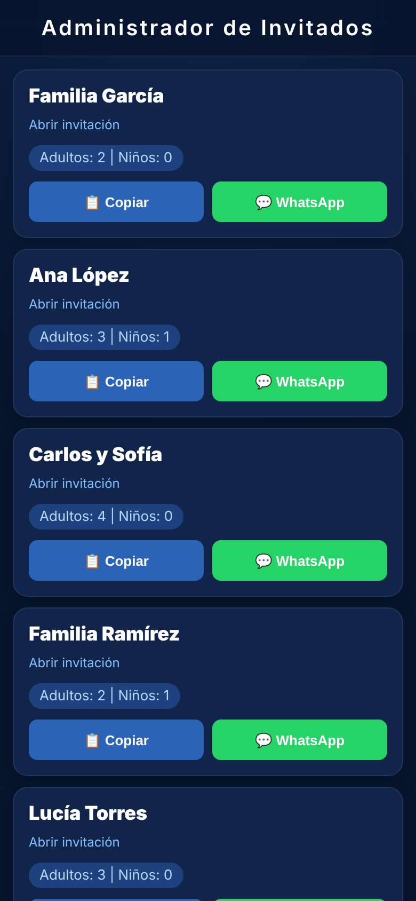
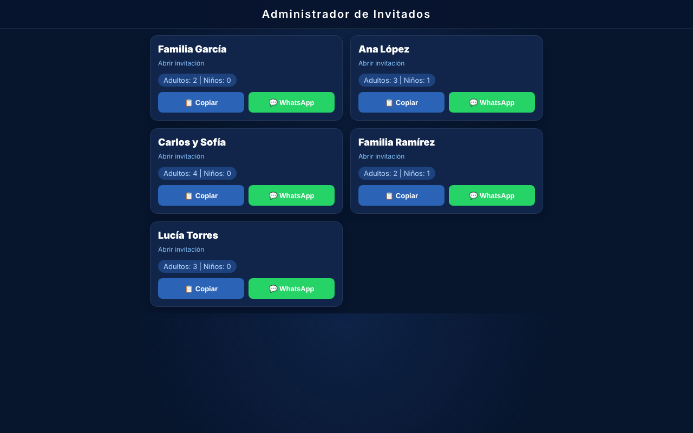

# Administrador de Invitados · Envío de pases personalizados

Panel para el organizador del evento: muestra a cada invitado con sus pases (adultos y niños) y permite copiar su enlace personal o enviarlo directo por WhatsApp. Complementa las invitaciones con boletos de **Mirai**.

  
  &nbsp;&nbsp;
  

> Las capturas usan datos de ejemplo.

## El problema

Repartir 50 o más invitaciones, cada una con un enlace y número de pases distinto, era un trabajo manual lleno de errores.

## Qué resolví

- **Tarjetas generadas desde JSON:** el panel se arma solo a partir de `files/links.json`.
- **Dos acciones por invitado:** copiar el enlace al portapapeles o abrir WhatsApp con el mensaje listo.
- **Enlaces únicos por invitado** (`?id=`), que la invitación usa para mostrar el nombre y los pases de cada persona.

## Stack

HTML5 · CSS3 · JavaScript vanilla (fetch, Clipboard API) · Netlify

---

Diseñado y desarrollado por **Adair Kevin** · Mirai
